  

  
  
  

I'm a fullstack developer from Brazil 🇧🇷, working with <b>C#/.NET</b> and <b>Python</b> across backend, frontend, and cross-platform apps.
I currently build payment systems at Grupo Autoglass: a cross-platform .NET MAUI app and its .NET API, talking directly to card terminals and running Pix through an in-house provider 💳.
Before that, I spent a few years on the Python side: AI agents integrated with LLMs, API SDKs, and RPA automations 🤖.

On the side, I'm building <b><a href="https://nerdifica.com">Nerdifica</a></b>, a personal project: a site of free online tools paired with blog articles, in Portuguese, Spanish, and English.
Each niche is a self-contained module that plugs into a Nuxt frontend and a FastAPI backend, and every push is tested, built into a container, and deployed with Docker Compose behind Nginx 🛠️.

<h3 align="center">Tech Stack</h3>

  
  
  
  
  
  
  
   
  
  
  
  
  
  
   
  
  
  
  
  
  

<h3 align="center">GitHub Stats</h3>

  
  

  

